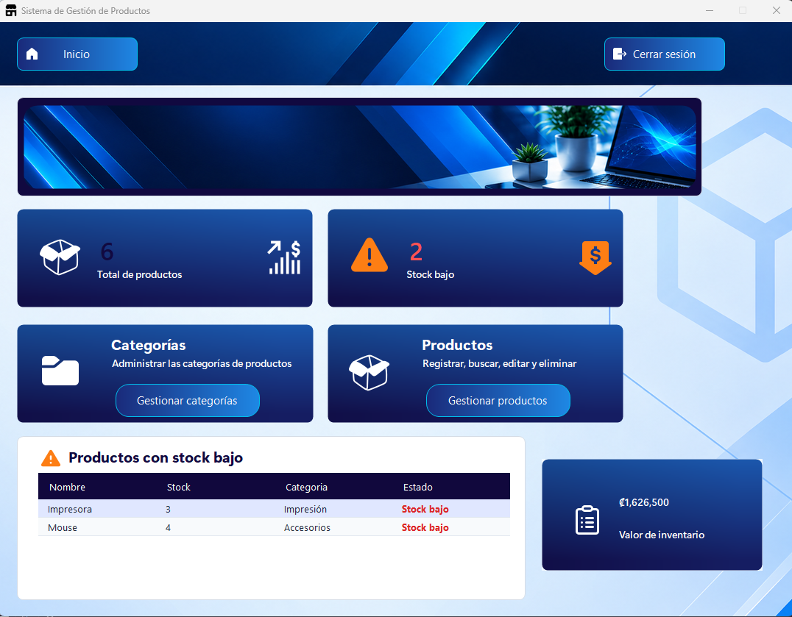
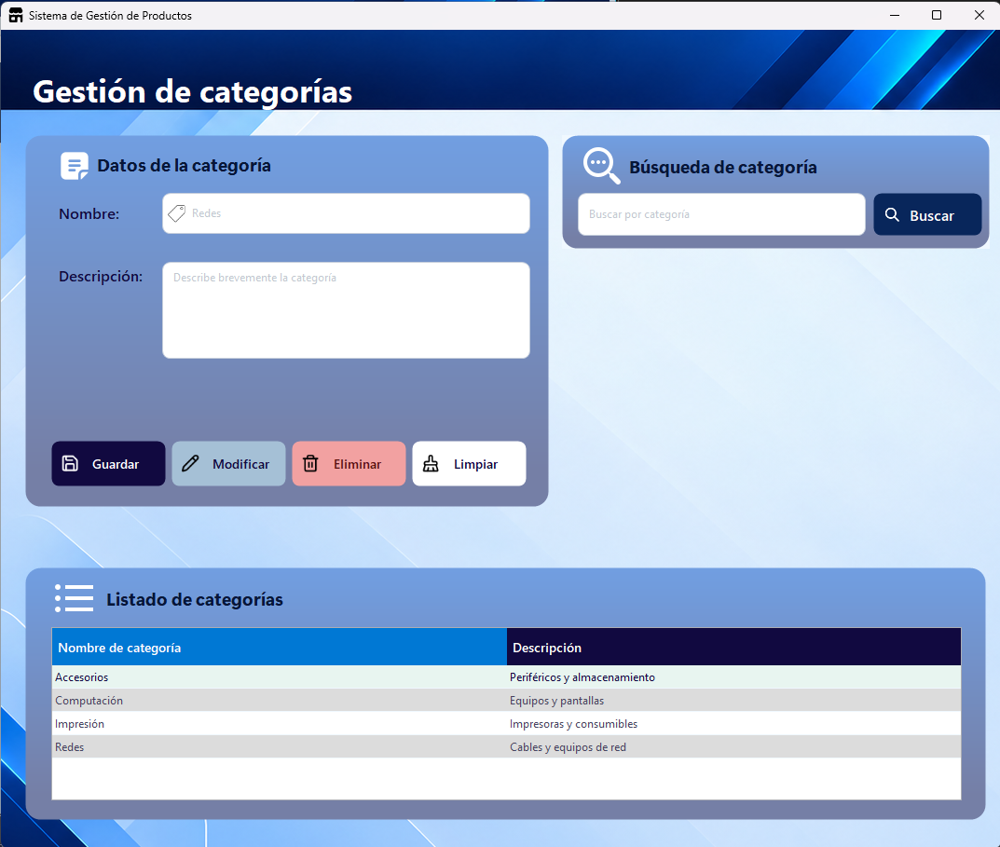
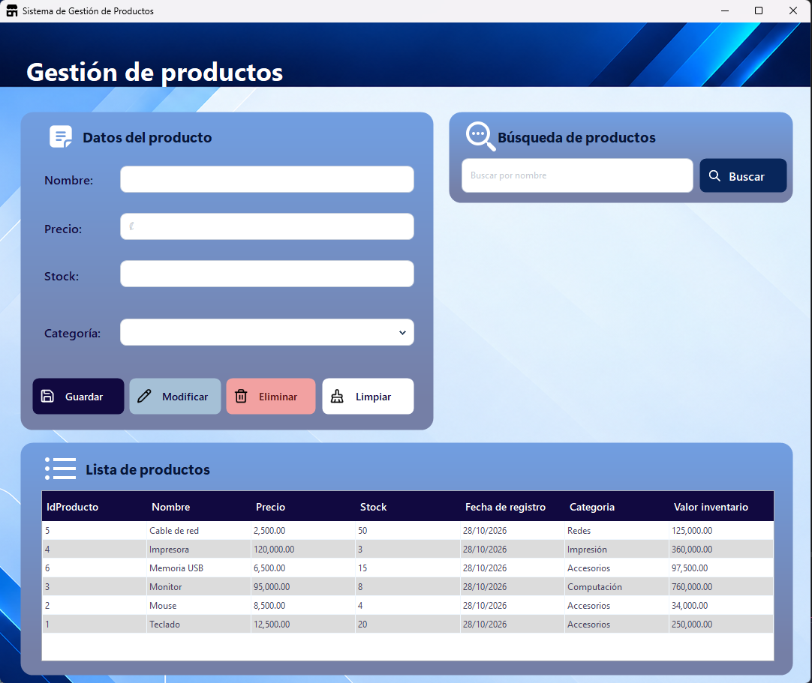

# TechStore – Sistema de Gestión de Productos

Aplicación de escritorio hecha en C# con Windows Forms y SQL Server. Sirve para administrar los productos de una tienda de tecnología: 
cada producto pertenece a una categoría y se pueden registrar, consultar, buscar, modificar y eliminar tanto categorías como productos.

| | |
|---|---|
| **Tarea** | Tarea programada: Sistema de Gestión de Productos |
| **Curso** | Programación II |
| **Profesor** | Ing. Joshua Granados Loría |
| **Universidad** | Universidad Internacional San Isidro Labrador |
| **Estudiante** | Grace Romero Sanabria |
| **Modalidad** | Individual |

---

## Funcionalidades

- **Categorías:** registrar, consultar, modificar, eliminar (con confirmación) y buscar por nombre.
- **Productos:** registrar, consultar, modificar, eliminar (con confirmación) y buscar por nombre. Cada producto se asigna a una categoría 
escogida desde un ComboBox.
- **Tabla de productos (DataGridView):** muestra identificador, nombre, precio, stock, fecha de registro, categoría y el valor del inventario de cada producto.
- **Valor del inventario:** se calcula en la aplicación como `Precio × Stock`. No se guarda en la base de datos.
- **Fecha de registro:** se asigna sola con `DateTime.Now` al registrar un producto.
- **Validaciones:** campos obligatorios, precio mayor que cero, stock igual o mayor que cero, datos numéricos válidos y categoría obligatoria. Los errores se muestran junto al control con un `ErrorProvider`.
- **Mensajes (MessageBox):** confirmación de eliminaciones, operaciones exitosas, errores y búsquedas sin resultados.
- **Extras que agregué:** inicio de sesión, botón para probar la conexión con SQL Server, y un panel principal con el total de productos, 
la cantidad con stock bajo (5 unidades o menos) y el valor total del inventario.

## Capturas






## Tecnologías

| Componente | Detalle |
|---|---|
| Lenguaje | C# |
| Plataforma | .NET 10, Windows Forms |
| Entorno | Visual Studio 2026 |
| Base de datos | Microsoft SQL Server Express, administrada con SSMS |
| Acceso a datos | ADO.NET con `Microsoft.Data.SqlClient` 7.1.1 (consultas parametrizadas) |
| Diseño de la interfaz | `Guna.UI2.WinForms` 2.0.4.8 (paquete NuGet) |

## Organización por capas

```
TechStore
├── Entidades      Categoria, Producto
├── Datos          ConexionSql, CategoriaDatos, ProductoDatos
│   └── BaseDatos  TechStoreDB.sql
├── Documentos	   Login.png, Principal.png, Categorias.png, Productos.png
├── Logica         CategoriaLogica, ProductoLogica
└── Presentacion   FrmLogin, FrmPrincipal, FrmCategorias, FrmProductos, AyudanteInterfaz
```

- **Presentacion:** formularios, controles, entrada de datos y presentación de la información.
- **Logica:** validaciones y reglas del sistema (por ejemplo, que el precio sea mayor que cero).
- **Datos:** todas las consultas SQL. Los formularios nunca escriben SQL.
- **Entidades:** las clases `Categoria` y `Producto`, con campos privados y propiedades `get`/`set`.

El camino de un dato al guardar es: formulario → lógica (valida) → datos (guarda en SQL Server).

## Base de datos

La base se llama `TechStoreDB` y tiene dos tablas relacionadas:

- **Categorias:** `IdCategoria` (llave primaria), `Nombre` (único), `Descripcion`.
- **Productos:** `IdProducto` (llave primaria), `Nombre`, `Precio`, `Stock`, `FechaRegistro`, `IdCategoria` (llave foránea hacia `Categorias.IdCategoria`).

Además hay restricciones `Precio > 0` y `Stock >= 0`. El script incluye datos de prueba (4 categorías y 6 productos).

## Requisitos para ejecutarlo

- Windows.
- Visual Studio 2026 con la carga de trabajo de **desarrollo de escritorio con .NET** (para .NET 10).
- SQL Server Express (o cualquier instancia de SQL Server) y SQL Server Management Studio.

## Instalación y ejecución

1. Clonar o descargar el repositorio y abrir `TechStore.slnx` en Visual Studio.
2. Abrir SSMS, conectarse a su servidor y abrir el archivo `Datos/BaseDatos/TechStoreDB.sql`.
3. Ejecutar el script completo. Crea la base `TechStoreDB`, las dos tablas, las restricciones y los datos de prueba.
4. Revisar la cadena de conexión (ver la siguiente sección).
5. En Visual Studio, esperar a que se restauren los paquetes NuGet y presionar **F5**.
6. En la pantalla de inicio de sesión se puede usar **Probar conexión** para confirmar que la aplicación llega a SQL Server.

### Conexión a SQL Server

La cadena de conexión está en `Datos/ConexionSql.cs`:

```csharp
Server=.\SQLEXPRESS;Database=TechStoreDB;Integrated Security=True;Encrypt=True;TrustServerCertificate=True;
```

Usa autenticación de Windows y la instancia local `SQLEXPRESS`. Si su instancia se llama distinto, hay que cambiar el valor de `Server` 
(por ejemplo `.` o `NOMBRE-PC\SQLEXPRESS`).

### Credenciales de acceso

| Usuario | Contraseña |
|---|---|
| `uisil` | `1234` |

Son credenciales de demostración que están escritas en `FrmLogin.cs`. Después de tres intentos fallidos la aplicación se cierra.

## Reglas de validación

| Campo | Regla |
|---|---|
| Nombre de categoría | Obligatorio, único y no puede ser solo un número |
| Descripción de categoría | Obligatoria |
| Nombre de producto | Obligatorio |
| Precio | Número mayor que 0 (máximo 99 999 999,99) |
| Stock | Número entero, igual o mayor que 0 |
| Categoría del producto | Hay que seleccionar una |

## Limitaciones conocidas

- El usuario y la contraseña están escritos en el código; no hay tabla de usuarios porque el enunciado limita la base a dos tablas.
- La cadena de conexión también está en el código y no en un archivo de configuración.
- El límite de stock bajo (5 unidades) es fijo.

## Uso de inteligencia artificial

Usé **Claude** (Anthropic) como apoyo para aprender, comprender, analizar y revisar, no para entregar el proyecto hecho. En concreto:

| Propósito | Parte del proyecto |
|---|---|
| Explicarme conceptos (clases, propiedades, encapsulamiento, capas, `TryParse`, `ErrorProvider`) | Todo el proyecto |
| Orientarme en el diseño de la base de datos y en la conexión con SQL Server | Script SQL, `ConexionSql`, clases de `Datos` |
| Revisar mi código y ayudarme a entender errores | Capas de `Logica` y `Presentacion` |
| Revisar el proyecto contra el enunciado | Revisión final |
| Revisar la redacción de la documentación | Este README |

El código lo escribí yo y puedo explicar cómo funciona cada parte.